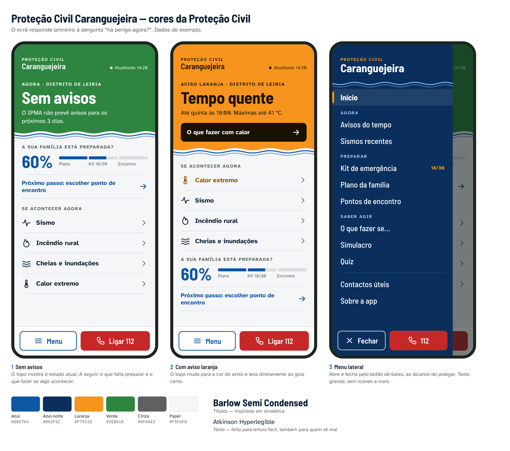

# Proteção Civil Caranguejeira — Plan

A free self-protection app for people in the parish of Caranguejeira (Leiria).
It works offline. It has the same kind of features as preparedness apps such as
K72 - Autoproteção, but everything else is our own: name, look, texts and a
local focus on Caranguejeira.

## What makes it ours (not a copy)

- **Own identity:** colours taken from the Caranguejeira coat of arms, a side menu opened from the bottom bar, our own typography and our own name.
- **Own texts:** written from official guidance (ANEPC, IPMA, SNS 24), not copied from other apps.
- **Local first:** Caranguejeira meeting points, local contacts and warnings for the Leiria district.

## Platform: installable web app (PWA)

The app is a website that can be installed on the phone like an app, without
Google Play or the App Store.

**How it works**

1. A person opens the website on their phone.
2. They install it. On Android, they tap an **"Instalar a app"** button on the website. On iPhone, they follow a short guide on the website.
3. An icon appears on the home screen, next to their other apps.
4. Tapping the icon opens the website in its own full-screen window, with no browser address bar. It looks and feels like an app.

**Installing on each platform**

| | Android (Chrome, Samsung Internet, Edge) | iPhone / iPad (Safari) |
|---|---|---|
| Install | The website shows an **"Instalar a app"** button. One tap installs it. | Apple doesn't allow an install button. The website shows a guide: **Partilhar → Adicionar ao ecrã principal**. |
| Result | Icon in the app drawer and home screen, opens full screen | Icon on the home screen, opens full screen |
| Notifications | Supported | Only after the app is added to the home screen (iOS 16.4 or later) |

On computers, Chrome and Edge can install it too. Otherwise it simply works as a normal website.

**What this means in practice**

- **One app for everyone.** The same code runs on Android, iPhone and computers.
- **Always up to date.** When the website is updated, the installed app updates by itself. Nobody has to download anything again.
- **Works offline.** After the first visit, the guides, contacts, kit checklist and family plan work with no internet.
- **Free.** It's hosted free on GitHub Pages, with HTTPS (which PWAs require). The address is <https://upcc.pt>.
- **No store accounts, fees or reviews.**

**Adapting to each device**

- **Phones:** the layout in the mockups, with the bottom bar and side menu. It respects the notch and the iPhone home bar. The phone's status bar takes the app colour.
- **Tablets and computers:** the side menu stays open permanently on the left, and the content is centred.
- **Install prompts:** the website detects whether it's opened from the installed icon. If so, it hides the "Instalar a app" button and guide.

**Limits to know**

- On iPhone, installing always takes the manual Share → Add to Home Screen steps. The guide on the website makes this easy, but it can't be one tap.
- Notifications for new IPMA warnings would need a small server to send them, which is not in the first version. At first, the app checks the warnings whenever it is opened.

**Technology:** plain HTML, CSS and JavaScript with no framework, so it stays
simple to change. It uses a web app manifest (name, icon, colours) and a service
worker (offline use). If it should ever be on Google Play, it can be wrapped as
a store app without rewriting it.

## Design principles

The app must not look like a generic template, with rounded cards, pastel icon
squares, gradients and a hamburger icon in the corner. Every design choice
comes from how the app is used: often by older people, sometimes under stress,
sometimes with one hand.

1. **Status first.** The top of the home screen answers "is there danger now?".
   It is green with "Sem avisos", or turns the colour of the IPMA warning
   (yellow, orange or red) and links straight to the right guide.
2. **Thumb reach.** The **Menu** and **Ligar 112** buttons sit in a fixed bar at
   the bottom of the screen, not in the top corner. The menu opens and closes
   from there too.
3. **Labelled buttons.** "Menu" is written next to its icon, because an icon on
   its own isn't clear to everyone.
4. **Readable for everyone.** The texts use Atkinson Hyperlegible, a font made
   for people with low vision. Text is large, contrast is strong, and every
   touch target is at least 44 px tall.
5. **Plain language.** Labels say what happens, for example "O que fazer se…",
   "Próximo passo: escolher ponto de encontro".
6. **Lists, not tiles.** Content is shown as full-width rows with dividers.
   They are faster to scan and bigger to tap than a grid of small cards.
7. **Proteção Civil colours, with a local touch.** The palette comes from the
   Proteção Civil logo. The wavy blue line under the status block and in the
   menu echoes the waves on the Caranguejeira coat of arms.

Visual proposal source: [`docs/mockup/index.html`](docs/mockup/index.html).

## Colours (from the Proteção Civil logo)

| Name | Hex | Source | Use |
|---|---|---|---|
| Azul | `#0B57A4` | logo ring and triangle | main brand colour: preparation progress, links, next step, Menu button, waves |
| Azul-noite | `#0A2F5C` | logo blue, dark | side menu background |
| Laranja | `#F7941D` | logo background | accent: active menu marker, menu highlights, orange warning |
| Verde | `#2E8540` | logo green, darkened for legibility | status block with no warnings |
| Cinza | `#5F6062` | logo outer ring | secondary text |
| Papel | `#F5F6F8` | — | app background |
| Tinta | `#0F1E33` | — | text (dark navy instead of black) |
| Fixed | `#F2C200` `#C62828` | — | IPMA yellow and red warnings, the 112 button |

The status block follows the IPMA warning scale: green, yellow, orange, red.
Two of those (green and orange) are also logo colours. Because the logo orange
is also the warning orange, orange elsewhere is kept to small accents. That way
a big orange area always means a warning.

White text on blue, navy and green meets the WCAG minimum contrast of 4.5:1.
Orange and yellow warnings use dark text.

The bottom of the side menu shows a sign-off with the unit name, **"Unidade Local de
Proteção Civil – Caranguejeira"**, and the Proteção Civil logo. The blue
triangle on orange in that logo is the international civil defence sign.
International law restricts its use to official civil protection services, so
the logo stays only if the unit is part of the official civil protection
structure or has authorisation.

**Fonts:** Barlow Semi Condensed for titles (inspired by road signage) and Atkinson
Hyperlegible for text. Both are free and will be bundled with the app so they work offline.

## Side menu

| Group | Item | What it does |
|---|---|---|
| — | **Início** | Current status, family preparation, "Se acontecer agora" |
| Agora | **Avisos do tempo** | Weather warnings for the Leiria district (live, saved for offline use) |
| Agora | **Sismos recentes** | Recent earthquakes on a map (IPMA data) |
| Preparar | **Kit de emergência** | 72-hour kit checklist, saved on the phone |
| Preparar | **Plano da família** | Family members, meeting points, important contacts, special needs |
| Preparar | **Pontos de encontro** | Map of Caranguejeira meeting points (OpenStreetMap) |
| Saber agir | **O que fazer se…** | What to do before, during and after each risk (list below) |
| Saber agir | **Simulacro** | Evacuation drill with a timer and steps |
| Saber agir | **Quiz** | Questions to test what you know |
| — | **Contactos úteis** | Tap to call: 112, SNS 24, Proteção Civil Municipal, Bombeiros, GNR, Junta |
| — | **Sobre a app** | Sources, privacy, credits, version |

The bottom bar always shows **Menu** and **Ligar 112**. When the menu is open, they become **Fechar** and **112**.
Just above them, the menu ends with "Unidade Local de Proteção Civil – Caranguejeira" and the Proteção Civil logo.

The menu, its labels and the content of each screen will be refined step by step.

**Risks covered in "O que fazer se…":** sismo, incêndio rural, incêndio em casa,
cheias e inundações, tempestade e vento forte, onda de calor, frio extremo,
acidente com matérias perigosas, falha prolongada de energia.

## Data and privacy

- No accounts, no ads, no tracking.
- The kit checklist, family plan and settings are stored only on the phone.
- The only network requests are for IPMA public data (warnings and earthquakes)
  and the map tiles. Everything else works offline.

## Build steps

Each step ends with something you can open and try on your phone.

1. ✅ **Foundation:** project structure, colours and fonts, bottom bar, side menu, home screen, empty screens. Installable from day one: manifest, provisional icon, "Instalar a app" button on Android and the guide on iPhone. Published on GitHub Pages so it can be installed and tested on a real phone.
2. ✅ **Contactos úteis + O que fazer se…:** tap-to-call contacts and the guides for every risk (offline). Only numbers confirmed on an official source can be called, and each shows its source and date. The guides put what to do now first.
3. ✅ **Kit de emergência:** 23 items in 6 categories with progress, saved on the phone. The home screen shows the kit count.
4. **Plano da família + Pontos de encontro:** family plan form and map with Caranguejeira points.
5. ✅ **Avisos do tempo + Sismos recentes:** live IPMA data, saved on the phone for offline use, with the status block on the home screen. The status shows the most serious warning for the Leiria district and links to the matching guide. Sea warnings (agitação marítima) only affect the coast, so they appear on the warnings screen but don't colour the home screen. If the data is more than 6 hours old, the app says so instead of "Sem avisos". The earthquakes screen lists everything within 100 km and, up to 400 km, those felt or of magnitude 3 or more. The earthquake map comes with the step 4 map.
6. **Simulacro + Quiz.**

**Content editing (done):** the kit, the useful contacts, the guides and the other texts live in
`app/conteudo/*.json`. Admins add, change and delete them with forms in Pages CMS, signing in by
email without a GitHub account. Each save publishes the app again. See "Edit the content" in the README.
7. **Offline and polish:** full offline support, final app icon and splash screen, tablet and computer layout, final tests on Android and iPhone.

## Needed from the owner

- **App name:** "Proteção Civil Caranguejeira" is a working title.
- **Meeting points:** places in the parish, with an address or a map pin.
- **Local phone numbers:** the Junta de Freguesia (244 734 437) is confirmed on jfcaranguejeira.pt. Still needed: the Bombeiros and the GNR post that serve the parish, and the Proteção Civil Municipal de Leiria (a 2021 municipal notice lists 244 849 700 for the Central Municipal de Operações de Socorro; check if it is still current). Add them in `app/js/contactos.js`.
- **Proteção Civil logo:** confirm the Unidade Local de Proteção Civil of Caranguejeira is official (or authorised) before release, since the logo contains the protected civil defence sign. Otherwise the menu footer keeps the unit name without the logo.
- **Coat of arms:** permission from the Junta de Freguesia before using it in the app or as its icon.
- **Review:** have the "O que fazer se…" texts reviewed by the municipal civil protection service before release.
- **IPMA:** confirm whether the warning times in the API are Portuguese local time (the app assumes so, as on the IPMA website), and how IPMA wants to be credited. Its terms ask for the IPMA logo with a link; the app shows "Fonte: IPMA" with a link until that is confirmed.
- **Sea warnings:** confirm that the home screen should ignore "agitação marítima" (coast only) for Caranguejeira.
